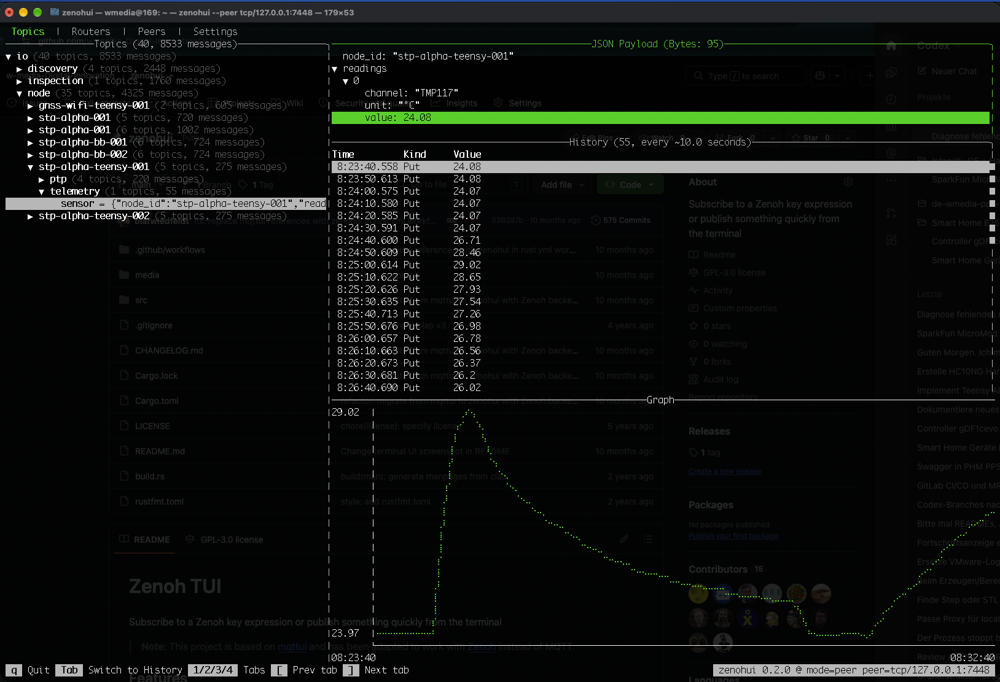

# Zenoh TUI

[](https://ratatui.rs/)

Subscribe to a Zenoh key expression or publish something quickly from the terminal

> **Note:** This project is based on [mqttui](https://github.com/EdJoPaTo/mqttui) and has been adapted to work with [Zenoh](https://zenoh.io/) instead of MQTT.

## Features

### Terminal UI



```bash
# Subscribe to everything (**). Defaults to peer mode with scouting.
zenohui

# Subscribe to a key expression
zenohui "demo/**"

# Subscribe using an explicit peer
zenohui --peer "tcp/127.0.0.1:7447" "demo/**"

# More arguments and details
zenohui --help
```

### Plot values from JSON payloads

Select a topic and press **Tab** to focus the JSON payload in the upper-right
panel. Use **Up/Down** to select a field and **Right** or **Enter** to expand
objects and arrays. Select a numeric value to plot its history automatically;
at least two valid samples are needed.

The screenshot above shows `readings[0].value`: expand **readings**, expand
**0**, then select **value** to see the temperature curve. The history table
also shows the selected field instead of the full JSON payload. Use **Left**
to collapse a branch and **Tab** to move to the history table.

### Connection settings (v0.2.0)

Press **4** to open Settings. Use Up/Down to select a field and Enter to edit
or toggle it. Enter/Esc ends text editing. Endpoints are comma-separated.
**F5** applies the connection in the background. On failure the current session
and history remain available; on success a fresh topic history is started.
Explicit listener addresses already in use by the current session can prevent
reconnection; restart with the new listener in that case.

**F2** saves the form to `zenohui-profile.json` in the working directory;
**F3** loads it without connecting. Profiles contain endpoint strings in plain
text. They are loaded only when requested. Press 1/2/3/4 or click the tab header
to navigate. While editing, these keys are entered as text.

Routers and Peers combine local discovery with the IDs of currently connected
nodes. The Status column distinguishes Connected from Discovered. Remote nodes
may have no advertised locators available through the session information API.

```bash
# Connect to a remote IPv4 router while retaining local peer discovery
zenohui --peer tcp/router.example.org:7447

# Client connection without local multicast discovery
zenohui --mode client --peer tcp/router.example.org:7447 --no-multicast
```

### Publish

```bash
zenohui publish "demo/hello" "world"

# Use stdin to publish file contents
zenohui publish "demo/hello" </etc/hostname
# or other things
cowsay "I was here" | zenohui publish "demo/hello"

# More arguments and details
zenohui publish --help
```

### Log to stdout

```plaintext
$ zenohui log "demo/**"
12:10:06.650 Kind:Put    demo/sensor/temp                          Payload(  6): 22.129
12:10:39.606 Kind:Put    demo/sensor/temp                          Payload(  6): 22.454
```

```bash
# Subscribe to a key expression
zenohui log "demo/**"

# Multiple key expressions
zenohui log "demo/sensor/**" "demo/actuator/**"

# More arguments and details
zenohui log --help
```

### Read a single payload to stdout

In scripts, it's helpful to get the current payload of a specific key.

```bash
# Print the first received sample to stdout and the key expression to stderr
zenohui read-one room/temp

# Save the payload to a bash variable to use it
temp=$(zenohui read-one room/temp)
echo "The temperature is $temp right now"

# More arguments and details
zenohui read-one --help
```

### Delete keys

Use the interactive TUI and press Delete or Backspace on a key to delete the tree or use the sub-command.

```plaintext
$ zenohui publish "demo/hello" "world"

$ zenohui clean "demo/hello"
Cleaned demo/hello
```

```bash
# Delete a key
zenohui clean "demo/hello"

# Delete a key tree below
zenohui clean "demo/**"

# More arguments and details
zenohui clean --help
```

### Configure via environment variables

See the `--help` command for environment variables to be set.

Personally I have set my default peer, so I don't have to use `--peer` all the time:

```bash
export ZENOHUI_PEER=tcp/127.0.0.1:7447

# Use the command without specifying the peer every time
zenohui "demo/**"
```

You can also configure listeners and the session mode:

```bash
export ZENOHUI_LISTEN=tcp/0.0.0.0:7447
export ZENOHUI_MODE=peer
```

## (WIP!) Install

There are generally 3 ways to install `zenohui`, in the order of preference: From your [package manager](#packaged), [prebuilt](#prebuilt) or [from source](#from-source)

### Packaged

> **Note:** zenohui is not yet available in package repositories. Please use [prebuilt binaries](#prebuilt) or [build from source](#from-source).

<!--
#### Alpine

```bash
apk add zenohui
```

#### Arch Linux

```bash
pacman -S zenohui
```

#### Homebrew (Mac or Linux)

```bash
brew install zenohui
```
-->

### Prebuilt

Check the [Releases](https://github.com/w-media-Digital-Innovation/zenohui/releases).

The filenames are similar to this: `zenohui-<version>-<architecture>-<platform>.zip`
Choose the correct file for your given CPU architecture and platform.

The prebuilt CPU architectures include:

- AMD/Intel: x86_64
- 64 bit ARMv8: aarch64
- 64 bit RISC-V: riscv64gc
- 32 bit ARMv7: armv7
- 32 bit ARMv6: arm

#### Debian, Ubuntu, and Deb based Linux

Download the appropriate `.deb` for your architecture and run:

```bash
sudo dpkg -i <downloaded file>
```

#### Red Hat, CentOS, and RPM based Linux

Download the appropriate `.rpm` for your architecture and run:

```bash
sudo rpm -i <downloaded file>
```

#### Tarball for other UNIX based systems

The binaries are also shipped as plain tarballs, targeting each architecture for any generic Linux or macOS.

Note that the Linux binaries are built for `glibc` based systems. You will need to compile [from source](#from-source) for other `libc`/`musl` systems like Alpine Linux (or install via repos).

You need to extract the tarball and put the binary somewhere on your path (common locations are `~/bin`, `~/.local/bin` or `/usr/local/bin`).

#### Windows

Download the appropriate `zenohui-<version>-<arch>-pc-windows-msvc.zip` for your architecture and extract the content somewhere useful.

### From Source

```bash
cargo install --path .
```

## Built with Zenoh 🦀

Zenohui is built on [Eclipse Zenoh](https://zenoh.io/), which powers its
publish/subscribe connections, key expressions and peer/router discovery.
Zenoh's Rust API lets us bring live data from devices and applications straight
into a terminal interface, from individual payloads to sensor histories and
graphs.

Thank you to the Zenoh maintainers and contributors for making this possible.
If you find zenohui useful, take a look at
[Zenoh on GitHub](https://github.com/eclipse-zenoh/zenoh), consider giving the
project a star, and explore the [documentation](https://zenoh.io/docs/) for
your own projects.

## Development checks

Run `python3 scripts/check.py` before proposing a commit. Rust, rustfmt and
Clippy versions are pinned; the same checks run in CI on Linux, macOS and
Windows. See [QUALITY.md](QUALITY.md) for the checks and release checklist.
